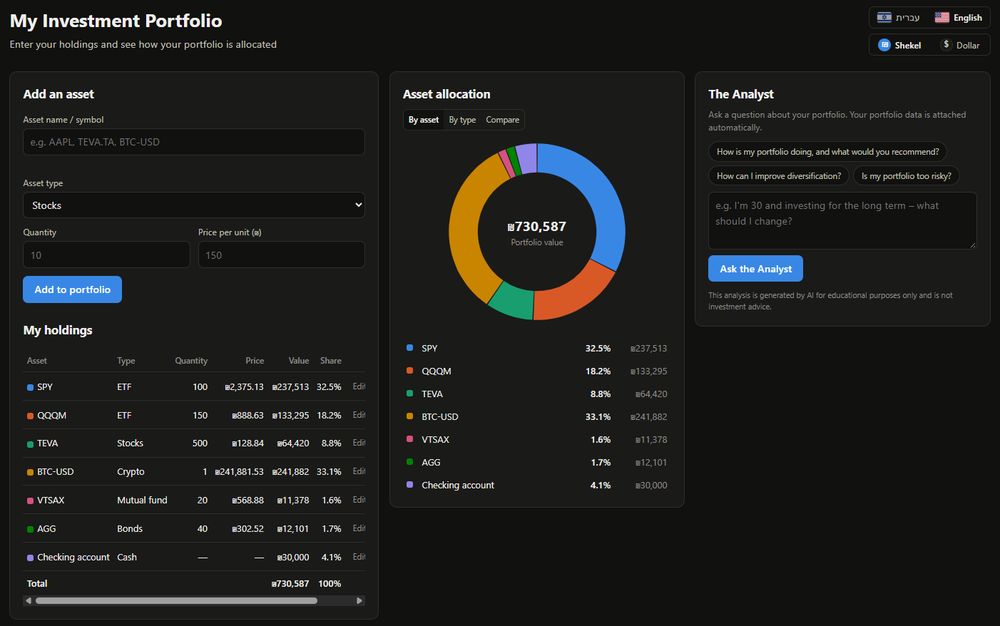

# Portfolio Analyzer

A web app for tracking and analyzing a personal investment portfolio: enter your holdings, see the allocation in a chart, and ask an analyst powered by **Google Gemini AI** questions about your portfolio.



---

## Features

### 📈 Real-time prices
- Prices for stocks, ETFs, crypto and more are fetched **in real time from the Yahoo Finance API** (`query1.finance.yahoo.com`).
- Any Yahoo symbol is supported: US stocks (`AAPL`, `SPY`), Tel Aviv Stock Exchange (`TEVA.TA`), crypto (`BTC-USD`) and more.
- **Automatic conversion to ILS (₪)** using the latest exchange rate (also from Yahoo). TASE shares priced in agorot are converted to shekels.
- 60-second server-side cache to avoid overloading the data source.

### 🍩 Portfolio allocation chart
- A donut chart showing the **portfolio allocation in percentages**, with the total value in the center.
- Two views: **by asset** or **by asset type** (stocks, bonds, crypto...).
- A holdings table with quantity, price, value and percentage of the portfolio, including edit and delete.
- Holdings are saved in a local **SQLite database**, so they persist across refreshes, browsers and server restarts.

### 🤖 The Analyst - powered by Gemini AI
- The "Analyst" panel lets you ask free-form questions about your portfolio, or pick a preset question (e.g. *"Is my portfolio too risky?"*, *"How can I improve diversification?"*).
- **Portfolio data is attached automatically to every question**: the server summarizes the holdings, values and allocation by type, and sends them to Gemini together with the question.
- The analyst addresses diversification, risk level, currency exposure and liquidity, and ends with practical recommendations.
- If the primary model (`gemini-3.5-flash`) is overloaded, the server automatically falls back to a backup model (`gemini-3.5-flash-lite`).
- **Chat history with a smart context window** - see below.
- ⚠️ The analysis is for educational purposes only and is not investment advice.

### 💾 Database & chat memory (SQLite)
- All data is stored in `data/portfolio.db` (created automatically on first run, never committed).
- **Full chat history** is stored in the database and reloaded on page load, so conversations persist across refreshes.
- **Sliding context window:** only the **last 10 conversation turns** (a turn = a question + its answer) are sent to Gemini, together with the current portfolio. This keeps the analyst aware of earlier context (age, goals, follow-ups) while preventing context bloat and keeping latency low.
- A question and its answer are saved together, only after a successful reply, so the history never contains a question without an answer.
- A **"Clear conversation"** button wipes the chat history.
- Holdings saved in the browser by older versions are **imported automatically** on first load.

> The app's interface is in Hebrew (RTL).

---

## Usage

1. **Add an asset** - enter a name/symbol (e.g. `AAPL`), choose the asset type and the number of units. The price is fetched automatically from the market (you can also enter it manually).
2. **View the portfolio** - the chart and table update immediately. Switch between the "by asset" and "by type" views.
3. **Ask the analyst** - type a question (e.g. *"I'm 30 and investing long-term - what should I change?"*) and click **Ask the Analyst**.

---

## Installation & Running

Requirements: Python 3.10+

```bash
pip install -r requirements.txt
```

Create a `.env` file (based on `.env.example`) with a Gemini API key from [Google AI Studio](https://aistudio.google.com/apikey):

```
GEMINI_API_KEY=your-key-here
```

Start the server:

```bash
python server.py
```

Then open http://localhost:8000 in your browser.

> Without an API key the app works as usual (prices and chart); only the analyst is unavailable.

---

## Database Schema

| Table | Columns |
|-------|---------|
| `portfolios` | `id` (PK), `name`, `created_at` |
| `holdings` | `id` (PK), `portfolio_id` (FK → portfolios), `symbol`, `asset_type`, `quantity`, `unit_price` |
| `chat_messages` | `id` (PK), `portfolio_id` (FK → portfolios), `role` (`user` \| `assistant`), `content`, `created_at` |

A **"Default Portfolio"** is created automatically on first run. `unit_price` is the last known price in ILS (from Yahoo Finance or entered manually).

## API

| Method | Endpoint | Description |
|--------|----------|-------------|
| `GET` | `/api/quote?symbol=AAPL` | Live price from Yahoo Finance, converted to ILS |
| `GET` | `/api/portfolio` | The portfolio and its holdings |
| `POST` | `/api/holdings` | Add a holding |
| `PUT` | `/api/holdings/<id>` | Update a holding |
| `DELETE` | `/api/holdings/<id>` | Delete a holding |
| `POST` | `/api/holdings/import` | One-time import of browser-saved holdings (only if the portfolio is empty) |
| `POST` | `/api/analyze` | Ask the analyst (`{"question": "..."}`) |
| `GET` | `/api/history?limit=100` | Recent chat messages |
| `DELETE` | `/api/history` | Clear the chat history |
| `GET` | `/api/status` | Whether the analyst (API key) is available |

## Project Structure

```
Portfolio-Analyzer/
├── public/              # Front end (the only folder served to the browser)
│   ├── index.html       # Page structure (RTL, Hebrew UI)
│   ├── styles.css       # Styling (dark mode)
│   └── app.js           # Client-side logic: holdings, chart, API calls
├── docs/
│   └── screenshot.png   # Screenshot used in this README
├── data/                # Created at runtime - SQLite database portfolio.db (not committed)
├── server.py            # Python server: static files, REST API, SQLite data layer, Gemini & Yahoo Finance
├── requirements.txt     # Python dependencies
├── .env.example         # Template for your .env file (API key settings)
└── .gitignore
```

> `.env` holds your private API key and is never committed - only `.env.example` (an empty template) is in the repo.

## Tech Stack

- **Frontend:** HTML, CSS, JavaScript (no libraries)
- **Backend:** Python (`http.server`)
- **Market data:** Yahoo Finance API
- **AI:** Google Gemini (`google-genai`)
- **Database:** SQLite (built into Python, no setup needed)
